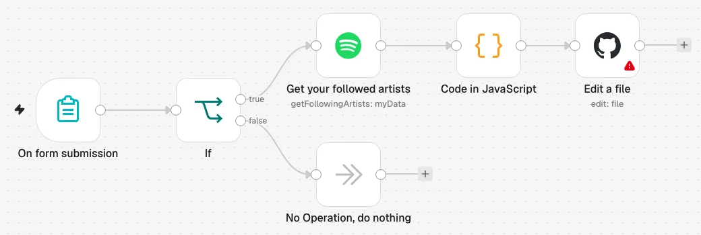
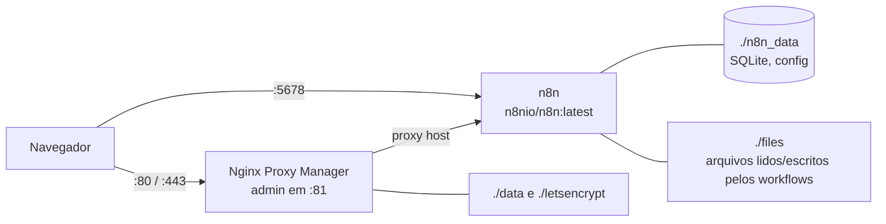

# n8n Docker

Ambiente local do [n8n](https://n8n.io) em Docker Compose, com o Nginx Proxy Manager na frente, scripts de backup/exportação e os workflows que eu montei versionados em JSON. Tem também uma stack "backup" maior, com Evolution API (WhatsApp), Typebot, PostgreSQL e Redis.



## O que tem aqui

- **Stack principal** (`docker-compose.yml`): n8n com SQLite em `./n8n_data` + Nginx Proxy Manager para publicar com domínio e HTTPS.
- **Stack backup** (`docker-compose-backup.yml`): n8n, Evolution API, Typebot (builder e viewer), Nginx Proxy Manager, PostgreSQL 15 e Redis, em portas diferentes para rodar ao lado da principal. Documentada em [README-backup.md](README-backup.md).
- **Workflows** em [`workflows/`](workflows/), exportados do n8n.
- **Scripts** de backup e exportação em [`scripts/`](scripts/).

## Como funciona



Os dois serviços ficam na rede `n8n_network`, então no Nginx Proxy Manager o proxy host aponta para `n8n:5678`.

## Workflows

| Arquivo | Nome | O que faz | Credenciais |
|---|---|---|---|
| `workflows/2Wok2ZR8G3ztnn7b.json` | My workflow | Formulário (nome, e-mail, senha) → `If` compara a senha → busca os artistas seguidos no Spotify → `Code` formata em Markdown → `GitHub` edita `docs/README.md` no repositório `Testen8n` | Spotify OAuth2, GitHub OAuth2 |
| `workflows/TradutorPDFGPT.json` | PDF to TXT Translator | Webhook `POST /pdf-upload` → lê `/files/<fileName>` → extrai o texto do PDF → divide em blocos de 3.000 caracteres → traduz com GPT-3.5 para pt-BR → junta e grava o TXT | OpenAI |

[`docs/LISTAR-ARTISTAS.md`](docs/LISTAR-ARTISTAS.md) é um exemplo da saída do primeiro workflow.

Para importar pela interface: **Workflows > Import from File**. Pela linha de comando, com o container de pé:

```bash
docker cp workflows/ n8n:/home/node/.n8n/import/
docker exec n8n n8n import:workflow --input=/home/node/.n8n/import/ --separate
```

As credenciais não vão no JSON; depois de importar, crie as suas no n8n e selecione nos nós.

## Como rodar

### Pré-requisitos

- Docker com Docker Compose v2
- Portas livres: 5678 (n8n), 80, 81 e 443 (Nginx Proxy Manager)

### Subir

```bash
git clone https://github.com/PeSzpak/n8n-docker.git
cd n8n-docker
cp .env.example .env
make up            # ou: docker compose up -d
```

- n8n: http://localhost:5678. No primeiro acesso o n8n pede para criar a conta de dono (e-mail e senha).
- Nginx Proxy Manager: http://localhost:81 (o login inicial é o padrão da imagem `jc21/nginx-proxy-manager`, trocado no primeiro acesso).

### Variáveis (`.env.example`)

| Variável | Valor de exemplo | Para que serve |
|---|---|---|
| `N8N_HOST` | `localhost` | Host público do n8n |
| `WEBHOOK_URL` | `http://localhost:5678/` | URL base dos webhooks |
| `N8N_ENCRYPTION_KEY` | `n8n-encryption-key-change-this-in-production` | Definida no `.env.example`, mas **não é repassada** ao container (ver limitações) |
| `N8N_USER`, `N8N_PASSWORD` | e-mail e senha | Viram `N8N_BASIC_AUTH_*`, que o n8n atual ignora (ver limitações) |
| `N8N_SECURE_COOKIE` | `false` | Permite login por HTTP local |
| `DB_SQLITE_POOL_SIZE` | `5` | Pool do SQLite |
| `N8N_RUNNERS_ENABLED` | `true` | Task runners para o nó Code |
| `N8N_ENFORCE_SETTINGS_FILE_PERMISSIONS` | `true` | Exige permissão restrita no arquivo de config |
| `N8N_BLOCK_ENV_ACCESS_IN_NODE` | `false` | Libera `$env` nos nós |
| `N8N_GIT_NODE_DISABLE_BARE_REPOS` | `true` | Bloqueia repositórios bare no nó Git |
| `SUBDOMAIN`, `DOMAIN` | `localhost` | Não são usadas pelo compose |

### Comandos do Makefile

| Comando | O que faz |
|---|---|
| `make up` / `make down` / `make restart` | Sobe, para e reinicia a stack |
| `make logs`, `make logs-n8n`, `make logs-nginx` | Logs de tudo, do n8n ou do proxy |
| `make status` | `docker compose ps` + `docker stats` dos dois containers |
| `make shell` | Shell dentro do container do n8n |
| `make pull` | Baixa a imagem mais recente do n8n |
| `make clean` | `docker compose down -v` **e** `docker system prune -f` (apaga também containers parados e imagens órfãs de outros projetos) |
| `make help` | Lista os comandos |

### Backup e exportação

```bash
./scripts/export-workflows.sh   # exporta todos os workflows para workflows/
./scripts/backup.sh             # gera backup-AAAAMMDD-HHMMSS.tar.gz com banco, config e workflows
```

Detalhes em [scripts/README.md](scripts/README.md).

### Reset completo

```bash
make down
rm -rf n8n_data/
make up
```

## Estrutura

```
.
├── docker-compose.yml          # n8n + Nginx Proxy Manager
├── docker-compose-backup.yml   # stack backup (n8n, Evolution API, Typebot, Postgres, Redis, NPM)
├── .env.example                # variáveis da stack principal
├── .env-backup                 # variáveis da stack backup
├── Makefile
├── scripts/                    # backup.sh, export-workflows.sh
├── workflows/                  # workflows exportados (JSON)
├── docs/                       # saída de exemplo e imagens do README
├── n8n_data/                   # criado na primeira execução (não versionado)
└── files/                      # criado na primeira execução, montado em /files
```

## Limitações conhecidas

- `N8N_BASIC_AUTH_ACTIVE/USER/PASSWORD` não existem mais desde o n8n 1.0; o login é a conta de dono criada no primeiro acesso, então `N8N_USER` e `N8N_PASSWORD` não têm efeito.
- `N8N_ENCRYPTION_KEY` está no `.env.example`, mas o `docker-compose.yml` não repassa essa variável ao container: o n8n gera uma chave própria em `n8n_data/config`. Perder essa pasta torna as credenciais salvas ilegíveis.
- O compose define `N8N_PROTOCOL=https` mesmo com o acesso local sendo por HTTP; isso afeta as URLs que o n8n gera (webhooks de teste, OAuth) quando `WEBHOOK_URL` não está definido.
- `workflows/TradutorPDFGPT.json` não importa no n8n 2.x (testado na 2.48.8): os nós `Function` foram descontinuados e precisam virar nós `Code`. Ele também usa `readBinaryFile`/`writeBinaryFile` e um nó `webhook` como resposta, que são de versões antigas.
- O `If` de `My workflow` compara a senha do formulário com um valor fixo dentro do JSON.
- `make diagnostico` chama `./diagnostico.sh`, que não existe no repositório.
- A imagem é `n8nio/n8n:latest`, então a versão muda a cada `make pull`.

## Licença

Não há arquivo `LICENSE` no repositório.
